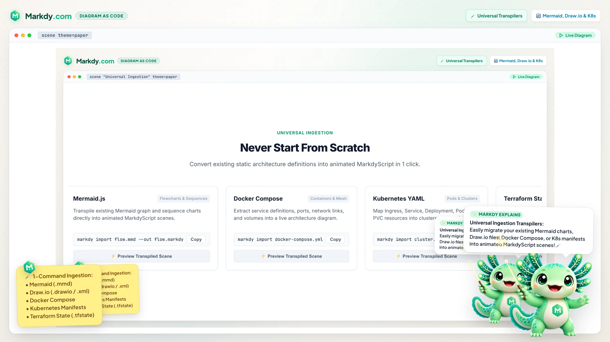
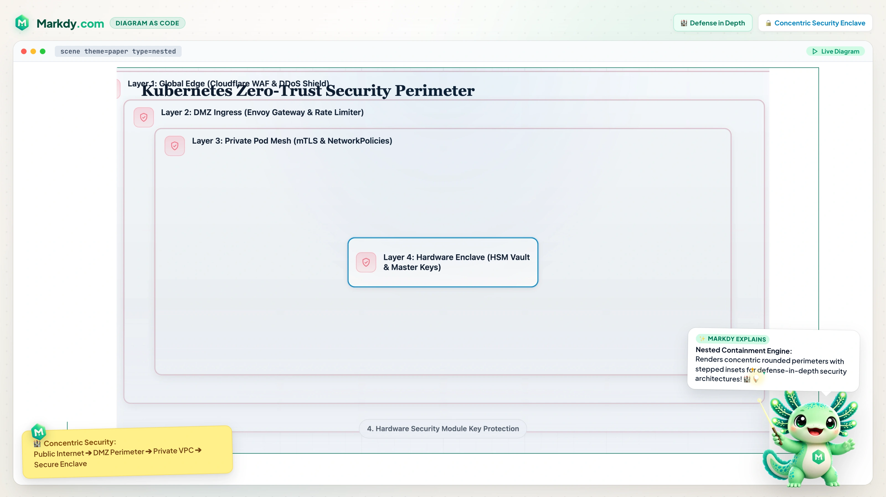

# @markdy/compat

<p align="center">
  <a href="https://markdy.com/playground/"></a>
  <a href="https://markdy.com/docs/"></a>
  <a href="https://markdy.com/examples/"></a>
  <a href="https://github.com/sponsors/HoangYell"></a>
  <a href="https://github.com/sponsors/HoangYell"></a>
</p>

Universal Ingestion Transpilers & Backwards-Compatibility Gate for Markdy.

`@markdy/compat` enables seamless migration from existing diagramming and infrastructure tools into animated, diagram-native MarkdyScript scenes.

> 💼 **Enterprise & Commercial**: Free under MIT. Access production architectural templates, custom diagram kits, and direct support via **[GitHub Sponsors & Pro Blueprints](https://github.com/sponsors/HoangYell)**.

---

## Features

- **Mermaid Transpiler**: Converts Mermaid Flowcharts (`flowchart LR/TB/TD`), Sequence Diagrams (`sequenceDiagram`), and State Diagrams (`stateDiagram-v2`) into animated Markdy scenes.
- **D2 & PlantUML Transpilers**: Converts D2 declarative scripts and PlantUML / C4 architecture diagrams into semantic MarkdyScript.
- **Graphviz DOT & Excalidraw Ingestion**: Converts `.dot`/`.gv` graphs and `.excalidraw` JSON boards with frame grouping and bound arrow labels.
- **Draw.io Ingestion**: Converts `.drawio` / `.xml` diagram graphs into structured MarkdyScript scenes with port attachments and label preservation.
- **Docker Compose Ingestion**: Parses `docker-compose.yml` into connected service topologies with port allocations and dependency order.
- **Kubernetes Manifests Transpiler**: Converts multi-document K8s manifests into namespace groups, ingresses, load balancers, and workloads.
- **Terraform State Ingestion**: Converts `.tfstate` files into VPC-clustered infrastructure diagrams.
- **Unified Auto-Detect Pipeline (`transpileToMarkdy`)**: Automatically detects the source format and applies theme, layout, and motion player presets. Try it live at **[markdy.com/convert/](https://markdy.com/convert/)**.
- **Backwards-Compatibility Snapshot Gate**: Automated regression test suite ensuring Markdy parser stability across releases.

<p align="center">
  <a href="https://markdy.com/playground/">
    
  </a>
</p>
<p align="center">
  <a href="https://markdy.com/playground/">
    
  </a>
</p>

---

## Programmatic API

```typescript
import {
  transpileMermaidToMarkdy,
  transpileDrawioToMarkdy,
  transpileDockerComposeToMarkdy,
  transpileKubernetesManifestsToMarkdy,
  transpileTerraformStateToMarkdy,
} from "@markdy/compat";

// 1. Mermaid Flowchart
const mermaidResult = transpileMermaidToMarkdy(`
  flowchart LR
    Client --> Gateway[API Gateway]
    Gateway --> DB[(Database)]
`);
console.log(mermaidResult.code);

// 2. Docker Compose
const composeCode = transpileDockerComposeToMarkdy(dockerComposeYamlString);

// 3. Kubernetes Manifests
const k8sCode = transpileKubernetesManifestsToMarkdy(k8sManifestYamlString);

// 4. Terraform State
const tfCode = transpileTerraformStateToMarkdy(tfstateJsonString);
```

---

## License

MIT © [Hoang Yell](https://hoangyell.com)
