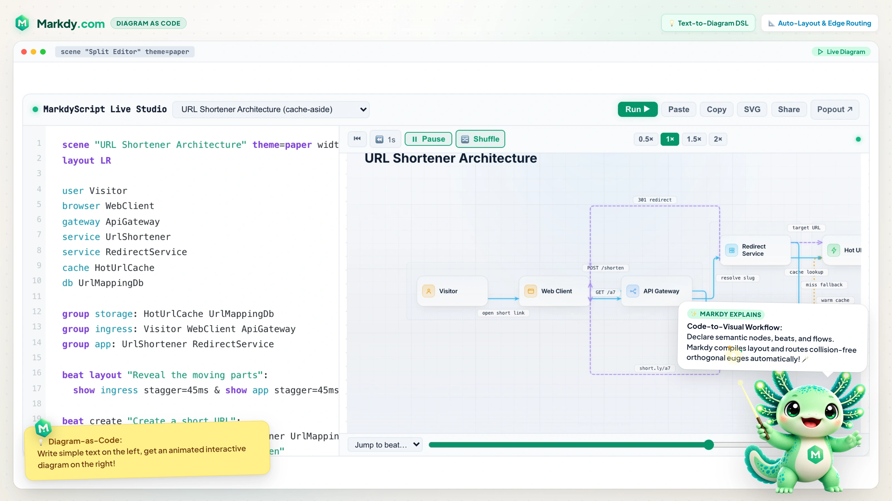
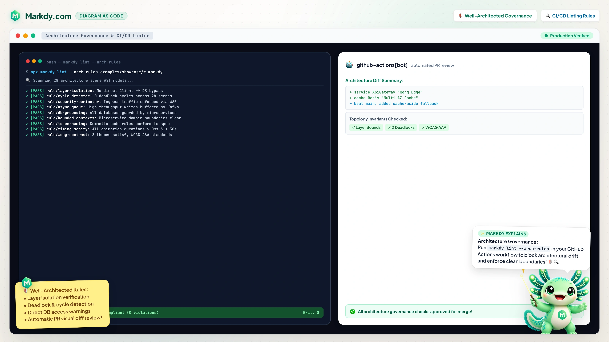

# @markdy/language-server

<p align="center">
  <a href="https://markdy.com/playground/"></a>
  <a href="https://markdy.com/docs/"></a>
  <a href="https://markdy.com/examples/"></a>
  <a href="https://github.com/sponsors/HoangYell"></a>
  <a href="https://github.com/sponsors/HoangYell"></a>
</p>

Language Server Protocol (LSP) server for MarkdyScript.

> 💼 **Enterprise & Commercial**: Free under MIT. Access production architectural templates, custom diagram kits, and direct support via **[GitHub Sponsors & Pro Blueprints](https://github.com/sponsors/HoangYell)**.

Current capabilities:
- parse diagnostics from `@markdy/core`
- completion for scene/layout/group/beat keywords, node kinds, cues, and declared node ids
- hover docs for beats and flow operators
- document symbols for declared nodes

## Package position (text)

```text
Editor -> @markdy/language-server -> @markdy/core parser

The server translates parse diagnostics and symbols into LSP responses.
```

## Output preview

<p align="center">
  <a href="https://markdy.com/playground/">
    
  </a>
</p>
<p align="center">
  <a href="https://markdy.com/playground/">
    
  </a>
</p>

Run on stdio:

```sh
npx @markdy/language-server
```
